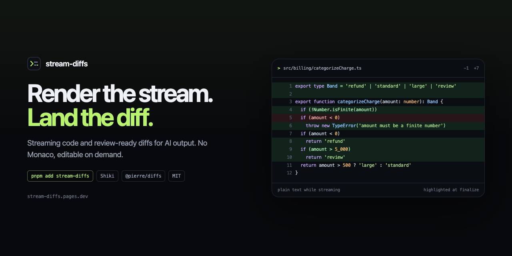
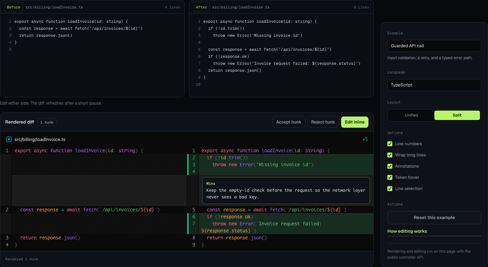

<p align="center">
  
</p>

# stream-diffs

[](https://www.npmjs.com/package/stream-diffs)
[](https://www.npmjs.com/package/stream-diffs)
[](https://github.com/Simon-He95/stream-diffs/actions/workflows/ci.yml)
[](https://stream-diffs.pages.dev/)
[](https://github.com/Simon-He95/stream-diffs/blob/main/LICENSE)

Stream-native syntax highlighting and review-ready diffs for AI output. Plain text while the answer arrives, one accurate highlight when it lands, and an optional inline editor when you need one. Powered by [`@pierre/diffs`](https://diffs.com) and Shiki. No Monaco model. No worker required.

[Live playground](https://stream-diffs.pages.dev/playground.html) | [Documentation](https://stream-diffs.pages.dev/) | [API reference](https://stream-diffs.pages.dev/api.html) | [Examples](https://stream-diffs.pages.dev/examples.html)

## Why stream-diffs

AI chat does not need a full code editor on every message. It needs a fast streaming path and a good review surface at the end.

- **Stream cheaply.** Deltas land in one plain `<pre>` with batching and viewport follow. No text model, no tokenization per chunk, no layout thrash.
- **Highlight once.** Finalization renders the complete snapshot with Shiki. Diffs are computed from complete text, so word-level highlights are accurate. The plain stream already uses the final file metrics, header, and gutter, so a file highlight lands without moving the code. Diff finalization switches to hunks by design.
- **Review for real.** Unified and split layouts, annotations, token hover, controlled selection, accept and reject, merge conflicts.
- **Edit on demand.** `startEditing()` loads the upstream editor chunk lazily, restores drafts, and keeps undo and redo inside the surface.
- **Stay small.** The root entry is framework-free, SSR-safe, and imports no renderer until `mount()`. First-party runtime is about 17.3 kB gzip.

## Install

```bash
pnpm add stream-diffs
```

```bash
npm install stream-diffs
```

Vue components are optional:

```bash
pnpm add stream-diffs vue
```

## Quick start

```ts
import { createCodeStream } from 'stream-diffs'

const output = createCodeStream({
  fileName: 'answer.ts',
  language: 'typescript',
  theme: { dark: 'github-dark', light: 'github-light' },
  maxHeight: 520,
  lineNumbers: true,
  autoScroll: 'near-bottom',
})

await output.mount(document.querySelector('#output')!)

for await (const delta of modelStream)
  output.append(delta)

await output.finalize({
  view: 'diff',
  original: previousSource,
  diffStyle: 'split',
  enableLineSelection: true,
})
```

The streaming view is intentionally plain text. Highlighting starts at `finalize()`, where one accurate render is worth the cost. Cumulative SDK snapshots are supported too:

```ts
output.updateSnapshot('export const ')
output.updateSnapshot('export const answer = 42')
```

## Review a static diff

```ts
import { createDiffSurface } from 'stream-diffs'

const review = createDiffSurface({
  kind: 'diff',
  oldFile: { name: 'src/cart.ts', contents: before, lang: 'typescript' },
  newFile: { name: 'src/cart.ts', contents: after, lang: 'typescript' },
  annotations: [{
    side: 'additions',
    lineNumber: 14,
    metadata: { author: 'Mina', body: 'Validate this input.' },
  }],
  options: {
    diffStyle: 'unified', // or 'split'
    diffIndicators: 'bars',
    lineDiffType: 'word-alt',
    enableLineSelection: true,
    renderAnnotation(annotation) {
      const node = document.createElement('div')
      node.textContent = annotation.metadata.body
      return node
    },
  },
})

await review.mount(document.querySelector('#review')!)
review.acceptReject(0, 'accept')
const resolved = review.getResolvedFile()
```

Inputs: `file`, `diff`, `patch`, and `merge-conflict`. Options, annotations, token hooks, custom headers, and worker pools use the same controller.

## Inline editing

Read-only by default. Start a session when the user asks for it:

```ts
const editor = await surface.startEditing({
  onChange: event => queueSave(event.file),
  onComplete: event => event.file.contents === saved ? 'reject' : 'accept',
}, 'review-draft')

surface.applyEdits(edits)
surface.undo()
surface.redo()
surface.stopEditing('complete')
```

The editor chunk loads only on the first session. `startEditing()` waits for hydration and the first attached render, so `applyEdits()` is immediately usable.

## Vue

```vue
<script setup lang="ts">
import { StreamCode, StreamDiff, StreamMergeConflict } from 'stream-diffs/vue'
</script>

<template>
  <StreamCode :code="answer" language="typescript" :loading="streaming" />
  <StreamDiff :original="before" :modified="after" diff-style="split" />
  <StreamMergeConflict :code="conflicted" language="typescript" />
</template>
```

`StreamCode` and `StreamDiff` keep streaming until `loading` is false and the block is visible, then finalize to one interactive surface. Every component exposes `getController()` through its ref.

## markstream-vue

`markstream-vue` automatically prefers `stream-diffs` when it is installed. Existing `MarkdownRender` and `CodeBlockNode` usage does not change:

```bash
pnpm add markstream-vue stream-diffs
```

```vue
<MarkdownRender :content="markdown" :loading="streaming" />
```

If both optional runtimes are installed, `stream-diffs` wins. Remove it to select `stream-monaco`.

## Try it live

The [playground](https://stream-diffs.pages.dev/playground.html) runs the public controller API:

- Edit both sources and watch the diff update.
- Switch unified and split layouts.
- Toggle annotations, token hover, and line selection.
- Start an inline edit session on the rendered diff.
- Resolve merge conflicts.
- Stream a file and finalize it to a diff or file.



Run the local lab with:

```bash
pnpm install
pnpm example
```

## Performance

From the recorded Chrome benchmark in markstream-vue (Chrome 150, 1440x1000, three repetitions):

| Metric | stream-diffs | stream-monaco |
| --- | ---: | ---: |
| median cold fallback visible | 72.4 ms | 913.0 ms |
| renderer DOM nodes | 31 | 405 |
| frame p95 | 10.2 ms | 16.6 ms |

Read the [methodology and all scenarios](https://stream-diffs.pages.dev/performance.html). These are machine-specific measurements, not fixed guarantees.

## Documentation

- [Introduction](https://stream-diffs.pages.dev/guide/introduction.html)
- [Quickstart](https://stream-diffs.pages.dev/guide/getting-started.html)
- [Streaming code](https://stream-diffs.pages.dev/guide/streaming.html)
- [Diffs and review](https://stream-diffs.pages.dev/guide/diffs.html)
- [Merge conflicts](https://stream-diffs.pages.dev/guide/merge-conflicts.html)
- [Inline editing](https://stream-diffs.pages.dev/guide/editing.html)
- [Vue](https://stream-diffs.pages.dev/guide/vue.html)
- [markstream-vue](https://stream-diffs.pages.dev/markstream-vue.html)
- [Framework recipes](https://stream-diffs.pages.dev/guide/recipes.html)
- [Troubleshooting](https://stream-diffs.pages.dev/guide/troubleshooting.html)
- [API reference](https://stream-diffs.pages.dev/api.html)
- [Type reference](https://stream-diffs.pages.dev/types.html)
- [中文说明](https://github.com/Simon-He95/stream-diffs/blob/main/README.zh-CN.md)

## Design constraints

- Read-only and append-only while streaming.
- Delta append is faster than cumulative snapshots.
- Streaming uses plain text; accurate diffs are generated from the final snapshot.
- No Monaco text model, completion, LSP, or diagnostics runtime.
- Cursor editing and undo belong to `surface.startEditing()` or `stream-diffs/edit`.
- `@pierre/diffs` loads on first mount, so importing `stream-diffs` remains SSR-safe.

## Contributing

Issues and PRs are welcome. See [CONTRIBUTING.md](https://github.com/Simon-He95/stream-diffs/blob/main/CONTRIBUTING.md) for setup, tests, the commit convention, and the release flow.

```bash
pnpm typecheck && pnpm test && pnpm build && pnpm docs:build
```

## License

MIT
