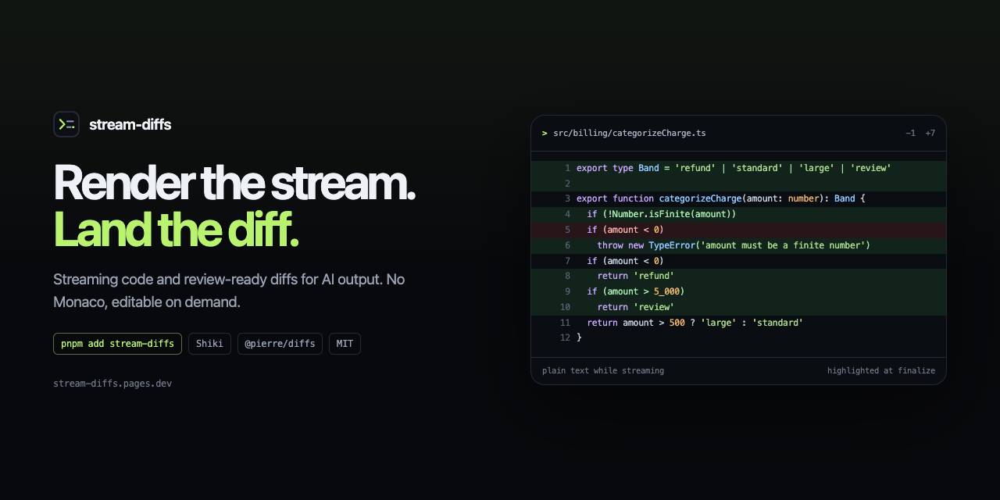
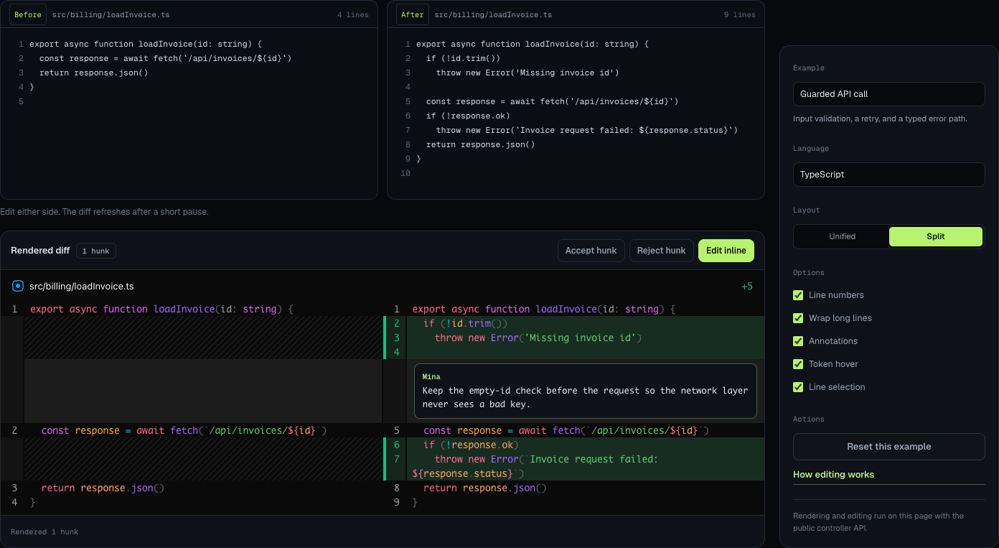

<p align="center">
  
</p>

# stream-diffs

[](https://www.npmjs.com/package/stream-diffs)
[](https://www.npmjs.com/package/stream-diffs)
[](https://github.com/Simon-He95/stream-diffs/actions/workflows/ci.yml)
[](https://stream-diffs.pages.dev/)
[](https://github.com/Simon-He95/stream-diffs/blob/main/LICENSE)

面向 AI 输出的流式代码高亮与可审阅 diff。回答还在生成时先以纯文本快速落地，完成时做一次准确高亮，需要时再按需加载行内编辑器。底层使用 [`@pierre/diffs`](https://diffs.com) 和 Shiki。不创建 Monaco model，不强制 worker。

[在线 Playground](https://stream-diffs.pages.dev/playground.html) | [文档站点](https://stream-diffs.pages.dev/) | [API 参考](https://stream-diffs.pages.dev/api.html) | [示例](https://stream-diffs.pages.dev/examples.html)

## 为什么用它

AI 聊天不需要在每条消息里塞一个完整代码编辑器。它需要一条足够便宜的流式路径，以及一个足够好的审阅界面。

- **流式便宜。** 增量写入同一个纯文本 `<pre>`，按帧合并，自动跟随底部。没有文本模型，没有逐 token 高亮，没有反复布局。
- **只高亮一次。** `finalize()` 用完整快照做一次 Shiki 渲染。Diff 也从完整内容计算，词级高亮是准确的。纯文本阶段已经使用最终文件的字宽、行高、头部和行号槽位，finalize 成 file 时高亮落下来不会移动代码；finalize 成 diff 会按设计切换到 hunk 视图。
- **真的能审阅。** 统一与分栏布局、行内注释、token hover、受控选区、接受与拒绝、合并冲突。
- **按需编辑。** `startEditing()` 才加载上游编辑器代码，支持草稿恢复、撤销与重做。
- **足够小。** 根入口无框架依赖，SSR 安全，`mount()` 前不加载渲染器。第一方运行时约 17.3 kB gzip。

## 安装

```bash
pnpm add stream-diffs
```

```bash
npm install stream-diffs
```

Vue 组件是可选的：

```bash
pnpm add stream-diffs vue
```

## 快速开始

```ts
import { createCodeStream } from 'stream-diffs'

const output = createCodeStream({
  fileName: 'answer.ts',
  language: 'typescript',
  theme: { dark: 'github-dark', light: 'github-light' },
  maxHeight: 520,
  lineNumbers: true,
  autoScroll: 'near-bottom',
})

await output.mount(document.querySelector('#output')!)

for await (const delta of modelStream)
  output.append(delta)

await output.finalize({
  view: 'diff',
  original: previousSource,
  diffStyle: 'split',
  enableLineSelection: true,
})
```

流式阶段刻意使用纯文本。高亮从 `finalize()` 开始，这时一次准确的渲染才值得成本。也支持累计快照：

```ts
output.updateSnapshot('export const ')
output.updateSnapshot('export const answer = 42')
```

## 渲染静态 diff

```ts
import { createDiffSurface } from 'stream-diffs'

const review = createDiffSurface({
  kind: 'diff',
  oldFile: { name: 'src/cart.ts', contents: before, lang: 'typescript' },
  newFile: { name: 'src/cart.ts', contents: after, lang: 'typescript' },
  annotations: [{
    side: 'additions',
    lineNumber: 14,
    metadata: { author: 'Mina', body: '提交前校验这个输入。' },
  }],
  options: {
    diffStyle: 'unified', // 或 'split'
    diffIndicators: 'bars',
    lineDiffType: 'word-alt',
    enableLineSelection: true,
    renderAnnotation(annotation) {
      const node = document.createElement('div')
      node.textContent = annotation.metadata.body
      return node
    },
  },
})

await review.mount(document.querySelector('#review')!)
review.acceptReject(0, 'accept')
const resolved = review.getResolvedFile()
```

支持 `file`、`diff`、`patch` 和 `merge-conflict` 四种输入。选项、注释、token 回调、自定义头部和 worker 池都走同一个 controller。

## 行内编辑

默认只读。用户需要时再开启：

```ts
const editor = await surface.startEditing({
  onChange: event => queueSave(event.file),
  onComplete: event => event.file.contents === saved ? 'reject' : 'accept',
}, 'review-draft')

surface.applyEdits(edits)
surface.undo()
surface.redo()
surface.stopEditing('complete')
```

编辑器代码只在第一次开启会话时加载。`startEditing()` 会等待 hydration 和首帧附着完成，因此返回后可以立即 `applyEdits()`。

## Vue

```vue
<script setup lang="ts">
import { StreamCode, StreamDiff, StreamMergeConflict } from 'stream-diffs/vue'
</script>

<template>
  <StreamCode :code="answer" language="typescript" :loading="streaming" />
  <StreamDiff :original="before" :modified="after" diff-style="split" />
  <StreamMergeConflict :code="conflicted" language="typescript" />
</template>
```

`StreamCode` 与 `StreamDiff` 在 `loading` 为 false 且组件可见时才切换到最终可交互界面。每个组件都通过 ref 暴露 `getController()`。

## markstream-vue

`markstream-vue` 在检测到 `stream-diffs` 时会自动优先使用它。已有 `MarkdownRender` 和 `CodeBlockNode` 用法不需要修改：

```bash
pnpm add markstream-vue stream-diffs
```

```vue
<MarkdownRender :content="markdown" :loading="streaming" />
```

两个可渲染 runtime 都安装时，`stream-diffs` 优先。移除它即可显式使用 `stream-monaco`。

## 在线体验

[Playground](https://stream-diffs.pages.dev/playground.html) 直接运行同一套公开 controller API：

- 修改两侧源码，实时查看 diff 刷新。
- 切换统一和分栏布局。
- 开关注释、token hover 和行选区。
- 在渲染后的 diff 上直接开启行内编辑。
- 解决合并冲突。
- 流式写入一段代码，再 finalize 成 diff 或文件。



本地实验页：

```bash
pnpm install
pnpm example
```

## 性能

来自 markstream-vue 的 Chrome 基准（Chrome 150，1440x1000，三次重复）：

| 指标 | stream-diffs | stream-monaco |
| --- | ---: | ---: |
| 冷启动 fallback 可见时间中位数 | 72.4 ms | 913.0 ms |
| 渲染器 DOM 节点数 | 31 | 405 |
| 帧 p95 | 10.2 ms | 16.6 ms |

完整场景与方法见[性能文档](https://stream-diffs.pages.dev/performance.html)。这些是特定机器上的测量结果，不是固定保证。

## 文档

- [介绍](https://stream-diffs.pages.dev/guide/introduction.html)
- [快速开始](https://stream-diffs.pages.dev/guide/getting-started.html)
- [流式代码](https://stream-diffs.pages.dev/guide/streaming.html)
- [Diff 与审阅](https://stream-diffs.pages.dev/guide/diffs.html)
- [合并冲突](https://stream-diffs.pages.dev/guide/merge-conflicts.html)
- [行内编辑](https://stream-diffs.pages.dev/guide/editing.html)
- [Vue](https://stream-diffs.pages.dev/guide/vue.html)
- [markstream-vue](https://stream-diffs.pages.dev/markstream-vue.html)
- [框架集成配方](https://stream-diffs.pages.dev/guide/recipes.html)
- [故障排查](https://stream-diffs.pages.dev/guide/troubleshooting.html)
- [API 参考](https://stream-diffs.pages.dev/api.html)

## 设计约束

- 流式阶段只读且只追加。
- 增量 append 比累计快照更快。
- 流式阶段使用纯文本，准确的 diff 从最终快照生成。
- 没有 Monaco 文本模型、补全、LSP 或诊断运行时。
- 光标编辑与撤销属于 `surface.startEditing()` 或 `stream-diffs/edit`。
- `@pierre/diffs` 在首次 `mount()` 时加载，因此 import `stream-diffs` 仍然 SSR 安全。

## 贡献

欢迎 issue 和 PR。开发、测试、提交规范与发布流程见 [CONTRIBUTING.md](https://github.com/Simon-He95/stream-diffs/blob/main/CONTRIBUTING.md)。

```bash
pnpm typecheck && pnpm test && pnpm build && pnpm docs:build
```

## 许可证

MIT
